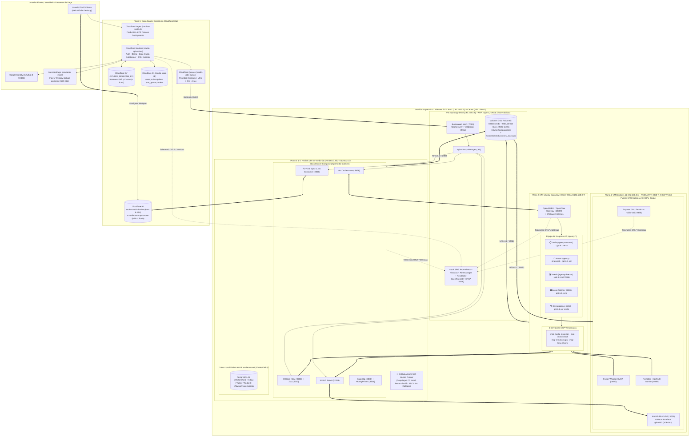

# Documento Maestro de Arquitectura v4.1: Agencia Digital de Marketing AI (Cloudflare Edge + Homelab Multi-Agente + GPU LAN + Metodología CI/CD & SRE)

* **Directorio Raíz del Proyecto:** `D:\Proyectos\Agencia Digital de Marketing AI`
* **Bóveda Maestra de Credenciales:** [`.env`](file:///D:/Proyectos/Agencia%20Digital%20de%20Marketing%20AI/.env) *(No versionado en Git — Respaldo obligatorio de todo secreto)*
* **Plan de Implementación Asociado:** [`docs/PLAN-DE-IMPLEMENTACION.md`](file:///D:/Proyectos/Agencia%20Digital%20de%20Marketing%20AI/docs/PLAN-DE-IMPLEMENTACION.md)

**Decisión vigente de almacenamiento (2026-11-05):** [ADR-001 — Usar `/volume2/producciones`](decisions/ADR-001-volumen-producciones.md), autorizada por el usuario; sustituye el destino anterior `/volume1/producciones`.

**Decisiones vigentes de alcance (2026-11-05):** [ADR-002 — MercadoPago inicial](decisions/ADR-002-pagos-mercadopago.md) sustituye la pasarela dual: primera versión únicamente MercadoPago para los cuatro planes; Flow y Webpay quedan para después. [ADR-003 — YuNet y AuraFace](decisions/ADR-003-modelos-faciales-comerciales.md) fija la selección facial interna con permisos publicados; su nueva inferencia CUDA está verificada en el cierre de Fase 3.

Este documento define la arquitectura integral de grado de producción para diseñar, desplegar, operar y mantener la **Agencia Digital de Marketing y Producción Audiovisual Autoatendible impulsada por Inteligencia Artificial**, construida bajo **Principios de Site Reliability Engineering (SRE)** y gobernada de extremo a extremo por **Pipelines CI/CD declarativos**:

1. **Plano 1 — Capa SaaS, Identidad, Suscripciones e Ingesta en Cloudflare Edge (`studio.e-scale.cl`):** Alojada en **Cloudflare Pages**, **Cloudflare Workers**, **Cloudflare D1**, **Cloudflare KV**, **Cloudflare R2** y **Cloudflare Queues**, con login obligatorio vía **Google OAuth 2.0**, **4 planes de suscripción (`Free`, `Pro`, `Ultra`, `Ilimitado`)** y **MercadoPago como único proveedor de pago inicial**. Flow y Webpay pertenecen al trabajo posterior de [ADR-002](decisions/ADR-002-pagos-mercadopago.md).
2. **Plano 2 — Equipo Especializado de 5 Agentes de IA (`192.168.0.7` — Open WebUI / OpenClaw):** Impulsados por **`openai/gpt-6.1-sol`** y **`openai/gpt-6.1-terra`**, conectados a **4 servidores MCP** y gobernados por un catálogo declarativo de **Skills con URLs exactas de repositorio**.
3. **Plano 3 — Gestión Audiovisual Open-Source (`192.168.0.85` — `vm-media-01`) y Almacenamiento NAS (`192.168.0.8`):** Basado en **CGWire Kitsu/Zou**, **Immich**, **n8n**, **SupoClip** y **MoneyPrinterTurbo**, respaldado por **Synology DSM (`/volume2/producciones`)** vía NFSv4.1 / SMB3.
4. **Plano 4 — Aceleración GPU Stateless vía LAN (`192.168.0.6` — NVIDIA RTX 3060 Ti):** Demonios sin estado para **Immich-ML (`:3003`)**, **Faster-Whisper CUDA (`:8000`)** y **Remotion + FFmpeg NVENC Worker (`:8090`)**.
5. **Plano 5 — Gobierno CI/CD, GitOps, Gestión de Secretos (`.env`) y Confiabilidad SRE (Transversal):** Pipelines automatizados con **GitHub Actions (Cloud)** + **GitHub Self-Hosted Runner en `vm-media-01` (`.85`)**, **7 Quality Gates bloqueantes**, **Preview Deployments**, **Smoke Tests E2E con Auto-Rollback (`< 90 s`)**, observabilidad unificada (**OpenTelemetry + Prometheus/Grafana + Alertas activas**), **SLIs/SLOs con Error Budgets**, **Backups 3-2-1 (Synology RAID + Cloudflare R2 Cifrado)** y documentación viva en `docs/ci/`.

---

## 0. Regla Arquitectónica Inquebrantable: Gobernanza de Credenciales en `.env`

> [!IMPORTANT]
> **Política Obligatoria de Respaldo Centralizado de Credenciales (`D:\Proyectos\Agencia Digital de Marketing AI\.env`):**
> 1. **Fuente Única de Verdad para Secretos:** Toda credencial, contraseña, token de API, llave de cifrado, secreto HMAC, ID de base de datos/namespace o token de servicio que sea **generado y/o utilizado** dentro de cualquier plano de la plataforma (**Cloudflare**, **vCenter/ESXi**, **Synology DSM**, **`vm-media-01` `.85`**, **`Ubuntu-Openclaw` `.7`**, **`Windows 11 GPU Bridge` `.6`**, **GitHub Actions** o **MercadoPago**, y cualquier proveedor futuro cuando se incorpore) **DEBE quedar respaldado inmediatamente en [`D:\Proyectos\Agencia Digital de Marketing AI\.env`](file:///D:/Proyectos/Agencia%20Digital%20de%20Marketing%20AI/.env)** antes de inyectarse en un servicio o contenedor.
> 2. **Prohibición de Secretos Huérfanos:** Ningún script o instalador puede generar contraseñas aleatorias en memoria (`openssl rand`, `New-RandomSecret`, plantillas Helm) y enviarlas directo a un contenedor o a la nube sin persistirlas primero en `D:\Proyectos\Agencia Digital de Marketing AI\.env`.
> 3. **Documentación por Variable:** Cada credencial agregada a `.env` debe incluir un bloque de comentario indicando:
>    * `# Para qué:` Qué autentica o cifra exactamente.
>    * `# Dónde:` En qué servidores, Workers o contenedores se inyecta.
>    * `# Riesgo al rotar:` Qué servicios deben reiniciarse o resincronizarse si cambia.
> 4. **Zero Secrets in Git:** El archivo `.env` jamás se versiona en Git (bloqueado por `.gitignore` y auditado en el **Quality Gate 1 con `gitleaks`**). En el repositorio solo se versiona [`.env.example`](file:///D:/Proyectos/Agencia%20Digital%20de%20Marketing%20AI/.env.example) con valores `CHANGE_ME`.

---

## 1. Diagramas de Arquitectura v4.1

### 1.1. Topología Integral de los 5 Planos (Cloudflare Edge + Homelab + Agentes IA + GPU + SRE/Observabilidad)

---

La auditoría de solo lectura del **2026-11-05 a las 21:45 UTC** observó estas capacidades de los sistemas de archivos montados; no acredita una capacidad agregada de 41 TB ni una topología RAID concreta:

| Volumen DSM | Capacidad observada | Espacio libre aproximado |
|---|---:|---:|
| `/volume1` | 182,25 GiB | 33,7 GiB |
| `/volume2` | 6094,56 GiB | 2753,63 GiB (2,69 TiB) |
| `/volume3` | 7935,92 GiB | 145 GiB |

La elección de `/volume2/producciones` sustituye la previsión anterior, según [ADR-001](decisions/ADR-001-volumen-producciones.md). El espacio libre es una observación compartida, no una reserva exclusiva para la plataforma. ESXi mantiene montado el datastore NFS `192.168.0.8:/volume2/NFS`; la auditoría no encontró máquinas virtuales registradas asociadas, lo que no demuestra ausencia de otros datos o consumidores. Conservar ese recurso y sus exportaciones. Evidencias locales: `.tools/evidence/synology-all-volume-capacity.json` y `.tools/evidence/vcenter-nfs-dependencies.json`.

El recurso `producciones`, los dos montajes NFSv4.1 y la lectura compartida por SMB3 cifrado cuentan con [evidencia real de Fase 2](ci/evidence/2026-11-05-fase-2.md), con cierre confirmado el 2026-11-05 tras 220 pruebas Python y controles finales aprobados. Los servicios de aplicación y respaldos representados siguen sujetos a la verificación de sus fases correspondientes.

### 1.2. Diagrama del Pipeline CI/CD Híbrido, Quality Gates y Auto-Rollback SRE (`docs/ci/diagrams/pipeline-overview.mmd`)

```mermaid
flowchart LR
    subgraph DEV ["1. Desarrollo & Pull Request"]
        COMMIT["Push rama feature/*\no apertura de PR"]
    end

    subgraph CI_GATES ["2. Quality Gates Bloqueantes (GitHub-Hosted Runner)"]
        G1["Gate 1: Secret Scan\n(gitleaks + .env.example sync)"]
        G2["Gate 2: Lint & Formato\n(eslint, prettier, ruff, shellcheck)"]
        G3["Gate 3: Typecheck Estricto\n(tsc --noEmit · Cloudflare & Remotion)"]
        G4["Gate 4: Unit & Contract Tests\n(vitest · Contratos JSON 5 Agentes & 4 MCPs)"]
        G5["Gate 5: Validación Infra & DB\n(docker compose config + D1 SQL dry-run)"]
        G6["Gate 6: Security & CVE Audit\n(npm audit + Trivy image/fs scan)"]
        G7["Gate 7: Doc & Diagram Lint\n(Verifica docs/ci/ actualizado)"]
    end

    subgraph PREVIEW ["3. Entorno Efímero PR"]
        CF_PREV["Deploy Preview Cloudflare\npreview-pr-<N>.studio.e-scale.cl\n+ D1 Preview DB"]
        SMOKE_PR["Smoke Test Preview\n(Playwright / API Check)"]
    end

    subgraph CD_PROD ["4. Entrega Continua en Merge a main"]
        MERGE["Merge a main\n(Tag inmutable sha-<commit>)"]
        SNAP["Pre-Deploy Safeguard\nSnapshot vCenter / Backup D1 & PG"]
        CD_CF["Deploy Cloudflare Prod\nPages + Worker + D1 Migrations"]
        CD_HOME["Self-Hosted Runner (.85)\n1. Reconcilia Docker Compose (.85)\n2. Sincroniza 5 Agentes/Skills/MCPs (.7)\n3. Verifica Demonios GPU (.6)"]
    end

    subgraph SRE_VERIFY ["5. Verificación Post-Deploy & Auto-Rollback (< 90s)"]
        SMOKE_PROD["E2E Smoke & Synthetic Check\n(/healthz Edge, :3010, :8081, :2283,\n:18789 Agentes, :8000/:8090 GPU)"]
        OK["✅ Deploy Exitoso\nRegistro en Grafana Annotations"]
        ROLLBACK["🚨 AUTO-ROLLBACK INMEDIATO\n1. wrangler rollback\n2. docker compose rollback sha previo\n3. Restaura openclaw.json previo\n4. Alerta Crítica al On-Call"]
    end

    COMMIT --> G1 --> G2 --> G3 --> G4 --> G5 --> G6 --> G7
    G7 -->|"En PR"| CF_PREV --> SMOKE_PR
    G7 -->|"Merge a main"| MERGE --> SNAP
    SNAP --> CD_CF & CD_HOME
    CD_CF & CD_HOME --> SMOKE_PROD
    SMOKE_PROD -->|"Todas las sondas HTTP 200"| OK
    SMOKE_PROD -->|"Fallo o Timeout > 90s"| ROLLBACK
```

---

## 2. Metodología CI/CD y Principios de Ingeniería de Confiabilidad (SRE)

Siguiendo las directrices de las skills **`ci-cd-and-automation`**, **`ci-cd-documentation-standard`** y **`runbook`**, ningún cambio de código, prompt de agente, servidor MCP, esquema de base de datos o `docker-compose.yml` se aplica manualmente en producción.

### 2.1. Los 7 Quality Gates Bloqueantes (Shift-Left Security & Quality)

Todo Pull Request hacia `main` debe superar obligatoriamente estos 7 portones en menos de 6 minutos:

| # | Quality Gate | Herramienta / Comando | Qué previene antes de llegar a Producción |
| :---: | :--- | :--- | :--- |
| **1** | **Detección de Secretos y Sincronía `.env.example`** | `gitleaks detect --source . -v` | Impide que secretos reales de `.env` entren a Git y verifica que toda clave nueva esté declarada como plantilla en `.env.example`. |
| **2** | **Linting Políglota** | `eslint`, `ruff check`, `shellcheck`, `PSScriptAnalyzer` | Estandariza código TypeScript (Workers/Remotion), Python (MCPs/GPU Workers), Bash (`setup.sh`) y PowerShell (`vcenter/`). |
| **3** | **Verificación de Tipos** | `npx tsc --noEmit` | Garantiza que los contratos de Cloudflare D1/Queues, el frontend Next.js y las composiciones de Remotion compilen sin errores. |
| **4** | **Pruebas Unitarias y de Contrato** | `vitest run --coverage` + `pytest` | Valida el *Edge Quota Gatekeeper* (planes `Free`/`Pro`/`Ultra`/`Ilimitado`), los webhooks de pago y los esquemas JSON (`brief.json`, `edl_spec.json`, `qa_verdict.json`) de los 5 agentes y 4 MCPs. |
| **5** | **Validación Declarativa de Infraestructura** | `docker compose config -q` + `wrangler d1 migrations apply --local` | Comprueba sintaxis de contenedores y aplica las migraciones SQL sobre un D1 efímero local antes de tocar la nube. |
| **6** | **Auditoría de Vulnerabilidades (SCA/Container)** | `npm audit --audit-level=high` + `trivy config / fs` | Bloquea dependencias con CVEs críticos o configuraciones inseguras en Dockerfiles. |
| **7** | **Integridad Documental CI/CD** | Verificador `docs/ci/` | Si el PR modifica `.github/workflows/` o manifiestos de despliegue, exige que el diagrama Mermaid y las recetas en `docs/ci/` se actualicen en el mismo PR. |

### 2.2. Entrega Continua (CD) Híbrida sin Exposición SSH a Internet

1. **Despliegue Cloud (Runner GitHub-Hosted):**
   * En **Pull Requests**: Despliega automáticamente una versión aislada en **Cloudflare Pages Preview (`preview-pr-<N>.studio.e-scale.cl`)** vinculada a una base D1 de *staging*.
   * En **Merge a `main`**: Ejecuta `wrangler d1 migrations apply studio-saas-db --remote`, despliega `studio-api-worker` y publica `studio-portal-web` en `studio.e-scale.cl`.
2. **Despliegue Homelab (GitHub Self-Hosted Runner en `vm-media-01` · `192.168.0.85`):**
   * El runner corre como servicio `systemd` sin privilegios root (`uid=1000`) dentro de `vm-media-01`, conectándose hacia GitHub por HTTPS saliente (`:443`). **No se abre ningún puerto SSH en el router hacia Internet**.
   * Al aprobarse un merge a `main`, el runner ejecuta localmente:
     * **Paso 1 (Salvaguarda Pre-Deploy):** Dispara un backup rápido de las bases de datos (`pg_dump` de Kitsu/Immich) y registra el hash de la versión activa (`PREV_SHA`).
     * **Paso 2 (Plano de Medios `.85`):** Ejecuta `docker compose pull && docker compose up -d --wait --remove-orphans` en `/opt/media-platform`.
     * **Paso 3 (Plano Cognitivo `.7`):** Ejecuta por LAN (`192.168.0.85 → 192.168.0.7`) el reconciliador idempotente `setup.sh` y `patch_config.py`, actualizando las Skills declaradas, los 4 servidores MCP y las identidades de los 5 agentes (`agency-*`).
     * **Paso 4 (Plano GPU `.6`):** Verifica y actualiza los servicios del Puente GPU (`192.168.0.6:3003/:8000/:8090`).

### 2.3. Smoke Test E2E Post-Deploy y Auto-Rollback (`< 90 segundos`)

Inmediatamente después de cada despliegue en `main`, el job `post-deploy-sre-gate` ejecuta una batería de sondas sintéticas durante una ventana de 90 segundos:
* `GET https://studio.e-scale.cl/api/healthz` (Verifica Worker + D1 + KV + R2).
* `GET http://192.168.0.85:3010/healthz`, `:8081/api/status` (Kitsu) y `:2283/api/server/ping` (Immich).
* `POST http://192.168.0.7:18789/health` (Verifica los 5 agentes `agency-*` y conexión a los 4 MCPs).
* `GET http://192.168.0.6:8000/health` y `:8090/healthz` (Verifica disponibilidad de CUDA y codificador `h264_nvenc` en la RTX 3060 Ti).

> [!CAUTION]
> **Política de Auto-Rollback Determinista:** Si cualquiera de las sondas devuelve error o excede el umbral de latencia durante la ventana de verificación, el pipeline ejecuta automáticamente `wrangler rollback` en Cloudflare, restaura el `docker-compose` y `openclaw.json` al `PREV_SHA` en `.85` y `.7`, verifica que el servicio vuelva a `HTTP 200` y envía una alerta con el log del fallo al canal de operaciones (WhatsApp Cloud API / SMTP).

---

### 2.4. Objetivos de Nivel de Servicio (SLIs, SLOs y Error Budgets)

| Servicio / Plano | Indicador de Nivel de Servicio (SLI) | Objetivo (SLO Mensual) | Presupuesto de Error (Error Budget 30d) | Acción Automática si se Quema el Error Budget |
| :--- | :--- | :---: | :---: | :--- |
| **1. Portal SaaS & Auth (`studio.e-scale.cl`)** | % de peticiones HTTP `2xx/3xx` y latencia `p95 < 150 ms` en `/api/auth/*` y `/api/upload/presign` | **99.9%** | `43.2 min / mes` | Congelamiento de despliegues (*feature freeze*) de UI/Worker hasta restaurar estabilidad. |
| **2. Ingesta Directa a Cloudflare R2** | % de subidas Multipart completadas sin error de firma ni corrupción de checksum | **99.9%** | `0.1% de subidas` | Reintento automático de chunk en Uppy + alerta de bucket R2. |
| **3. Transcripción GPU (`Faster-Whisper :8000`)** | Tiempo de transcripción por minuto de audio (`p95 < 8 seg` por cada 60s de video) | **99.0%** | `7.2 horas / mes` | Supervisor propio reinicia exclusivamente su hijo Whisper con Job Object y espera creciente; el encolado en Cloudflare Queue corresponde a la integración posterior. |
| **4. Render & Masterización GPU (`Remotion NVENC :8090`)** | % de renders finalizados con sonoridad integrada en `-14.0 ± 1.0 LUFS` y `TP <= -1.0 dBTP` | **99.5%** | `0.5% de renders` | Re-ejecución automática del paso de normalización `ebur128` antes de pasar a Elena 🔍. |
| **5. Ciclo Completo del Equipo de Agentes (`.7`)** | Tiempo total de entrega en *Piloto Automático* para un Reel de 60s (`p95 < 6 minutos` incluyendo hasta 2 rondas QA) | **99.0%** | `1% de órdenes` | Si una ronda de agente supera 120s, timeout limpio + reintento con backoff exponencial. |

---

### 2.5. Continuidad Operativa, Estrategia de Backups 3-2-1 y Retención Automática

| Activo Crítico | RPO (Pérdida Máx.) | RTO (Tiempo Recup.) | Mecanismo Automatizado (Cron / Pipeline) | Destino Primario (Local) | Destino Secundario (Offsite Cloud) |
| :--- | :---: | :---: | :--- | :--- | :--- |
| **Bóveda Maestra `.env`** | `Inmediato` | `< 1 min` | Copia cifrada con `restic` / `age` en cada cambio de credencial | `D:\Proyectos\Agencia Digital de Marketing AI\.env` | Bucket R2 `studio-backups-bucket` (Cifrado con `RESTIC_PASSWORD`) |
| **Cloudflare D1 (`studio-saas-db`)** | `< 1 hora` | `< 5 min` | Time Travel nativo de D1 (30 días) + Export SQL diario vía Worker Cron (`03:00 AM`) | `/volume2/producciones/_backups/d1/` | Bucket R2 `studio-backups-bucket` |
| **PostgreSQL Kitsu & Immich (`.85`)** | `< 24 horas` | `< 15 min` | `pg_dumpall --clean` comprimido con `zstd` (`03:30 AM`) + verificación de integridad | `/volume2/producciones/_backups/postgres/` (Synology DSM) | Bucket R2 `studio-backups-bucket` (Retención 30 días) |
| **Configuración & Memorias de Agentes (`.7`)** | `< 24 horas` | `< 10 min` | Snapshot + `tar.zst` de `~/.openclaw/` y memorias `MEMORY.md` (`04:00 AM`) | `/volume2/producciones/_backups/openclaw/` | Bucket R2 `studio-backups-bucket` |
| **VM Completa `vm-media-01` (`.85`)** | Pre-cambio | `< 3 min` | Snapshot automático vía PowerCLI en vCenter (`192.168.0.2`) antes de cada actualización mayor de SO/Docker | `datastore1` (rotación máxima de 2 snapshots por VM) | Reconstruible 100% desde código (`01-deploy-media-vm.ps1`) |

---

## 3. Arquitectura SaaS en Cloudflare Edge, Autenticación y Planes de Suscripción

### 3.1. Recursos Desplegados en Cloudflare

| Recurso Cloudflare | Nombre Técnico | Función en la Arquitectura |
| :--- | :--- | :--- |
| **Cloudflare Pages** | `studio-portal-web` (`studio.e-scale.cl`) | Aloja el frontend Next.js/React con entornos `production` y `preview` por cada PR. |
| **Cloudflare Workers** | `studio-api-worker` (`studio.e-scale.cl/api/*`) | Backend *serverless* en el borde: **Google OAuth 2.0**, **MercadoPago** como único proveedor inicial, *Edge Quota Gatekeeper* y exportación de trazas OpenTelemetry. |
| **Cloudflare D1** | `studio-saas-db` | Base de datos SQLite distribuida en el borde (`users`, `subscriptions`, `plan_quotas`, `usage_ledger`, `orders`) con migraciones versionadas en CI/CD. |
| **Cloudflare KV** | `STUDIO_SESSIONS_KV` | Caché de sesiones JWT y cuotas activas por usuario (`< 5 ms`). |
| **Cloudflare R2** | `studio-media-bucket` + `studio-backups-bucket` | Ingesta directa con *Presigned Multipart URLs*, distribución CDN de Kits Finales (0 egress fee) y bóveda cifrada de backups DRP. |
| **Cloudflare Queues** | `studio-jobs-queue` (+ `studio-jobs-dlq`) | Cola priorizada por plan (`Ilimitado` > `Ultra` > `Pro` > `Free`) con **Dead-Letter Queue (DLQ)** para órdenes que requieran reintento SRE. |

### 3.2. Matriz Oficial de los 4 Planes de Suscripción

| Característica / Capacidad | Plan `Free` (Prueba) | Plan `Pro` (Creadores / PyMEs) | Plan `Ultra` (Growth / E-Commerce) | Plan `Ilimitado` (Agencias / Multi-Marca) |
| :--- | :---: | :---: | :---: | :---: |
| **Autenticación Requerida** | Google OAuth 2.0 | Google OAuth 2.0 | Google OAuth 2.0 | Google OAuth 2.0 |
| **Cuota Mensual de Producciones** | **1 Reel / mes** | **12 Reels / mes** | **40 Reels / mes** + Auto-Clipping (`SupoClip`) | **Ilimitado** (*Fair Use* en cola rápida) |
| **Duración Máxima de Salida** | Cuota comercial pendiente de Fase 6 | Cuota comercial pendiente de Fase 6 | Cuota comercial pendiente de Fase 6 | Cuota comercial pendiente de Fase 6; piezas largas segmentadas |
| **Marca de Agua y Calidad** | 1080p **con marca de agua sutil** | 1080p **sin marca de agua** (`-14 LUFS`) | 1080p / 4K **sin marca de agua** + B-Roll IA (`Immich`) | 1080p / 4K + **Export ProRes 4444 Alfa** |
| **Modelos y Equipo de Agentes** | Flujo base (`gpt-6.1-terra`) | Equipo completo **5 Agentes (`gpt-6.1-sol` + `gpt-6.1-terra`)** | Equipo completo + **Prioridad Alta en GPU** | Equipo completo + **Prioridad Máxima en GPU** |
| **Modos de Trabajo** | Solo *Piloto Automático* | *Piloto Automático* y *Co-Piloto* | *Piloto Automático* y *Co-Piloto* | *Piloto Automático*, *Co-Piloto* y **Multi-Marca** |
| **Rondas de Auto-Iteración (`Elena 🔍`)** | 1 pasada QA | Hasta **2 rondas autónomas (`v1 → v2`)** + 1 ajuste humano | Hasta **3 rondas autónomas (`v1 → v2 → v3`)** + 3 ajustes humanos | **3 rondas autónomas** + **iteraciones humanas ilimitadas** |
| **Kit de Entregables** | Video 9:16 + Caption básico | Video 9:16 + Covers (`9:16`/`4:5`) + Copy SEO (`ig-human`) + Secuencia Stories/DM | Todo `Pro` + **Kit de Testeo Meta Ads (`dynamic_creative`)** + Acceso **Kitsu Frame Review** | Todo `Ultra` + **Memoria dedicada por Marca** + Webhooks/API |
| **Retención Automática (R2 / NAS)** | 7 días (2 GB) | 30 días (25 GB) | 90 días (100 GB) | Continua (500 GB+) |

---

### 3.3. Alcance inicial de pagos y selección facial

Por [ADR-002](decisions/ADR-002-pagos-mercadopago.md), MercadoPago es el único proveedor inicial del catálogo `Free`, `Pro`, `Ultra`, `Ilimitado`. Flow y Webpay quedan en el trabajo posterior; Stripe ya no es requisito de esta entrega. Las reservas históricas de la bóveda y plantilla se conservan y no bloquean ese alcance. La consulta autenticada de prueba ya identifica un usuario sandbox de Chile, según `.tools/evidence/mercadopago-authentication.json`; no acredita checkout, webhooks, suscripciones ni cobros reales. La integración funcional corresponde a Fase 6.

Por [ADR-003](decisions/ADR-003-modelos-faciales-comerciales.md), el servicio facial interno usa el ID propio `agency_yunet_auraface_v1`: detector YuNet 2023mar con MIT declarada y solo el reconocedor `glintr100.onnx` de AuraFace-v1 con Apache-2.0 publicada. El [manifiesto](../gpu-bridge-win11/face-artifacts.json) fija revisiones, hashes y documentos de licencia. Se conservan el protocolo Immich y los modelos GPT exactos del equipo; los embeddings previos no se reutilizan por tener igual dimensión. La última prueba instalada verificó CLIP textual/visual, detección y reconocimiento facial con perfiles CUDA, un rostro y 8,594 segundos (`immich-inference-final-deployed.json`); las mediciones anteriores se conservan como historia. Las licencias declaradas no constituyen certeza jurídica sobre todos los datos de entrenamiento.

El renderizador aplica un límite operativo común de 600 segundos por pieza y 20 minutos de procesamiento, con dos trabajos simultáneos compartidos entre formatos y operaciones. Las cuotas comerciales se definirán en Fase 6. Los modelos permanecen en la caché privada de `C:\GPU-Bridge`; temporales y bundle Remotion reconstruible usan `D:\Proyectos\Agencia Digital de Marketing AI\.tools\gpu-render-cache`, con propiedad y ACL privadas verificadas antes de inyectar la ruta. Los medios finales siguen en NAS. El firewall propio y ocho consultas de salud desde `.85`/`.7`, con ocho rechazos de token incorrecto, ya están verificados; se probaron también ausencia de Bearer y rechazo por socket local no permitido pese a una cabecera suplantada. Esto último no es una prueba desde otro equipo LAN.

El servicio final aprobó MP4 H.264 NVENC 1080p de 3 s en 20,313 s —`-14,00 LUFS`/`-1,50 dBTP`— y 4K de 1 s en 20,859 s —`-14,00 LUFS`/`-2,85 dBTP`—, con 30 fps, tres etiquetas BT.709 y marca Free cuando corresponde. MOV ProRes 4444 alfa de 1 s aprobó 1080p/4K en 16,547/41,485 s: `prores_ks` en CPU, PCM 24 bits/48 kHz, audio `-14,00 LUFS`/`-2,84 dBTP` y alfa mínimo 0 en muestra decodificada 64×64 a 0,5 s. No se atribuye NVENC a ProRes ni se presenta el muestreo como verificación de todos los fotogramas. Las inspecciones conservaron regla QA `Y=0..1920`, escala 0,5 en 4K y tres capturas. Los renders previos de 3 s permanecen archivados separadamente.

La concurrencia final aprobó dos archivos HTTP 200 en 29,672/29,797 s y un tercero 429 en 0,719 s, con 36 muestras globales NVIDIA y máximo dos sesiones. El responsable certificó la **Fase 3 verificada operativamente**, con cierre documental de 2026-11-06: 17 fuentes nativas y 20 del renderer, 14 hashes NAS revalidados, cuatro salud 200/ready, tres hijos sanos e identidad propia verificada sin detener. La [evidencia de cierre](ci/evidence/2026-11-05-fase-3.md) conserva errores y correcciones de color/audio, fuentes y controles; el certificado funcional no es un snapshot de disco. SLO p95, arranque tras reiniciar Windows, workflows remotos, CD, integración server de Fase 4 y backups futuros permanecen fuera de lo acreditado.

## 4. Diseño del Equipo de 5 Agentes (`192.168.0.7`) y Catálogo Declarativo de Skills con URLs Exactas

### 4.1. Asignación de Modelos, Roles y MCPs por Agente

| ID del Agente | Identidad y Rol | Modelo OpenAI | Skills Asignadas | MCPs Asignados | Responsabilidad Principal |
| :--- | :--- | :---: | :--- | :--- | :--- |
| **`agency-account`** | **Sofía 📋** *Account Manager & Analista de Ingesta* | `openai/gpt-6.1-terra` | `product-marketing`, `onboarding`, `protocolo-agencia-audiovisual` | `mcp-media-inspector` `mcp-kitsu-review` | Recibe al usuario autenticado, valida los parámetros de su Plan (`Free`/`Pro`/`Ultra`/`Ilimitado`), levanta el brief, ejecuta la radiografía técnica de los archivos y abre el entregable en Kitsu. |
| **`agency-strategist`** | **Mateo 🧠** *Estratega de Marketing & Brainstorming Viral* | `openai/gpt-6.1-sol` | `ig-reel`, `ig-viral`, `ig-caption`, `ig-story`, `ig-dm`, `ig-human`, `ig-carousel`, `ig-plan`, `marketing-psychology`, `cro`, `ab-testing`, `ad-creative`, `copywriting`, `social`, `video`, `meta-ads` | `mcp-immich-broll` | Diseña los 3 ángulos creativos, ganchos basados en las 26 fórmulas de `ig-reel`, texto de tarjetas de valor (**sin repetir la voz**), copy humanizado (`ig-human`) y el Kit de Stories/DM o `dynamic_creative` para Meta Ads. |
| **`agency-director`** | **Valeria 🎬** *Directora Audiovisual & Showrunner* | `openai/gpt-6.1-sol` *(Visión)* | `edicion-de-video`, `remotion-dev`, `remotion-best-practices`, `video`, `protocolo-agencia-audiovisual` | `mcp-media-inspector` `mcp-immich-broll` | Analiza con Visión la tira de contactos graduada (`Y: 0..1920px`), mide dónde caen ojos, barbilla y logos a ocultar, selecciona el B-Roll semántico en Immich y redacta la Escaleta Técnica (`edl_spec.json` + `tokens.ts`). Arbitra las rondas de iteración. |
| **`agency-editor`** | **Lucas 🎞️** *Ingeniero de Montaje Remotion & Audio Mastering* | `openai/gpt-6.1-terra` | `remotion-dev`, `remotion-best-practices`, `edicion-de-video`, `ai-image-generation`, `ai-video-generation`, `operacion-worker-remotion-gpu` | `mcp-remotion-gpu` `mcp-kitsu-review` | Traduce el `edl_spec.json` de Valeria a componentes React/Remotion (`Reel.tsx`, `Captions.tsx`, `tokens.ts`), invoca el render de Stills QA y el render final `h264_nvenc` a `-14 LUFS` en `192.168.0.6:8090`, aplica marca de agua si el plan es `Free` y sube la versión a Kitsu. |
| **`agency-critic`** | **Elena 🔍** *Auditora Multimodal de Calidad (Visual, Audio y Copy)* | `openai/gpt-6.1-sol` *(Visión)* | `rubrica-qa-audiovisual`, `edicion-de-video`, `ig-human`, `ig-audit`, `cro` | `mcp-remotion-gpu` `mcp-kitsu-review` | Inspecciona con Visión los fotogramas renderizados (`qa/f<N>.png`), la telemetría `ebur128` y el copy con una rúbrica de 0 a 100. Si el puntaje es `< 85` o viola una regla dura, devuelve dictamen quirúrgico a Valeria y Lucas para iterar (`v1 → v2 → v3`). |

---

### 4.2. Declaración Oficial de Skills con URLs Exactas de Repositorio

#### A. Suite Especializada de Instagram y Humanización (`jakeschincariol/instagram-agent-skill`)
* **Repositorio Git:** https://github.com/jakeschincariol/instagram-agent-skill.git
* **Comando de instalación CLI:** `npx skills add https://github.com/jakeschincariol/instagram-agent-skill -y -g`

| Skill ID | Agente(s) | URL Directa al `SKILL.md` Oficial | Propósito Técnico |
| :--- | :--- | :--- | :--- |
| **`ig-reel`** | `Mateo 🧠` | https://github.com/jakeschincariol/instagram-agent-skill/blob/main/skills/ig-reel/SKILL.md | 26 fórmulas probadas de Hooks, estructura de guion hablado, texto en pantalla y *timed beat sheet*. |
| **`ig-viral`** | `Mateo 🧠` | https://github.com/jakeschincariol/instagram-agent-skill/blob/main/skills/ig-viral/SKILL.md | Ingeniería inversa de estructuras virales y patrones de retención por nicho. |
| **`ig-caption`** | `Mateo 🧠` | https://github.com/jakeschincariol/instagram-agent-skill/blob/main/skills/ig-caption/SKILL.md | Redacción de la primera línea que sobrevive al corte `... más`, cuerpo SEO, CTA único y 3 hashtags. |
| **`ig-story`** | `Mateo 🧠` | https://github.com/jakeschincariol/instagram-agent-skill/blob/main/skills/ig-story/SKILL.md | Secuencia de Stories cuadro por cuadro con stickers interactivos para llevar tráfico a DM. |
| **`ig-dm`** | `Mateo 🧠` | https://github.com/jakeschincariol/instagram-agent-skill/blob/main/skills/ig-dm/SKILL.md | Guiones de entrega por palabra clave en DM y secuencias de seguimiento conversacional. |
| **`ig-human`** | `Mateo 🧠`, `Elena 🔍` | https://github.com/jakeschincariol/instagram-agent-skill/blob/main/skills/ig-human/SKILL.md | Eliminación de huellas de IA (*em-dashes*, palabras cliché, caracteres invisibles) y panel detector de 5 pruebas. |
| **`ig-carousel`** | `Mateo 🧠` | https://github.com/jakeschincariol/instagram-agent-skill/blob/main/skills/ig-carousel/SKILL.md | Diseño de carruseles `1080×1350` complementarios al Reel. |
| **`ig-plan`** | `Mateo 🧠` | https://github.com/jakeschincariol/instagram-agent-skill/blob/main/skills/ig-plan/SKILL.md | Planificación de calendario semanal y distribución de piezas. |
| **`ig-audit`** | `Elena 🔍` | https://github.com/jakeschincariol/instagram-agent-skill/blob/main/skills/ig-audit/SKILL.md | Auditoría de rendimiento de piezas publicadas y diagnóstico de retención. |

#### B. Suite de Marketing Digital, Psicología y Conversión (`coreyhaines31/marketingskills`)
* **Repositorio Git:** https://github.com/coreyhaines31/marketingskills.git
* **Catálogo Web:** https://skills.sh/coreyhaines31/marketingskills
* **Comando de instalación CLI:** `npx skills add https://github.com/coreyhaines31/marketingskills -y -g`

| Skill ID | Agente(s) | URL Directa al `SKILL.md` Oficial | URL en `skills.sh` |
| :--- | :--- | :--- | :--- |
| **`product-marketing`** | `Sofía 📋` | https://github.com/coreyhaines31/marketingskills/blob/main/skills/product-marketing/SKILL.md | https://skills.sh/coreyhaines31/marketingskills/product-marketing |
| **`onboarding`** | `Sofía 📋` | https://github.com/coreyhaines31/marketingskills/blob/main/skills/onboarding/SKILL.md | https://skills.sh/coreyhaines31/marketingskills/onboarding |
| **`marketing-psychology`** | `Mateo 🧠` | https://github.com/coreyhaines31/marketingskills/blob/main/skills/marketing-psychology/SKILL.md | https://skills.sh/coreyhaines31/marketingskills/marketing-psychology |
| **`cro`** | `Mateo 🧠`, `Elena 🔍` | https://github.com/coreyhaines31/marketingskills/blob/main/skills/cro/SKILL.md | https://skills.sh/coreyhaines31/marketingskills/cro |
| **`ab-testing`** | `Mateo 🧠` | https://github.com/coreyhaines31/marketingskills/blob/main/skills/ab-testing/SKILL.md | https://skills.sh/coreyhaines31/marketingskills/ab-testing |
| **`ad-creative`** | `Mateo 🧠` | https://github.com/coreyhaines31/marketingskills/blob/main/skills/ad-creative/SKILL.md | https://skills.sh/coreyhaines31/marketingskills/ad-creative |
| **`copywriting`** | `Mateo 🧠` | https://github.com/coreyhaines31/marketingskills/blob/main/skills/copywriting/SKILL.md | https://skills.sh/coreyhaines31/marketingskills/copywriting |
| **`social`** | `Mateo 🧠` | https://github.com/coreyhaines31/marketingskills/blob/main/skills/social/SKILL.md | https://skills.sh/coreyhaines31/marketingskills/social |
| **`video`** | `Mateo 🧠`, `Valeria 🎬` | https://github.com/coreyhaines31/marketingskills/blob/main/skills/video/SKILL.md | https://skills.sh/coreyhaines31/marketingskills/video |

#### C. Suite de Meta Ads, Remotion Oficial y Generación Visual IA
| Skill ID | Agente(s) | URL de Repositorio / `skills.sh` | Comando Exacto de Instalación |
| :--- | :--- | :--- | :--- |
| **`meta-ads`** | `Mateo 🧠` | https://skills.sh/kostja94/marketing-skills/meta-ads https://github.com/kostja94/marketing-skills | `npx skills add kostja94/marketing-skills@meta-ads -y -g` |
| **`remotion-best-practices`** | `Valeria 🎬`, `Lucas 🎞️` | https://github.com/remotion-dev/skills https://github.com/remotion-dev/skills/blob/main/skills/remotion/SKILL.md | `npx skills add https://github.com/remotion-dev/skills -y -g` |
| **`ai-image-generation`** | `Lucas 🎞️` | https://skills.sh/agentspace-so/runcomfy-agent-skills/ai-image-generation https://github.com/agentspace-so/runcomfy-agent-skills | `npx skills add agentspace-so/runcomfy-agent-skills@ai-image-generation -y -g` |
| **`ai-video-generation`** | `Lucas 🎞️` | https://skills.sh/halt-catch-fire/skills/ai-video-generation https://github.com/halt-catch-fire/skills | `npx skills add halt-catch-fire/skills@ai-video-generation -y -g` |

#### D. Skills Propias de Ingeniería Audiovisual, Remotion, CI/CD y SRE
| Skill ID | Agente(s) / Equipo | Ruta Maestra y URL file:// de Origen | Función |
| :--- | :--- | :--- | :--- |
| **`edicion-de-video`** | `Valeria 🎬`, `Lucas 🎞️`, `Elena 🔍` | [SKILL.md](file:///C:/Users/Jorge%20Andrade/.gemini/config/skills/edicion-de-video/SKILL.md) | Pipeline de 9 pasos para Reels 9:16: inspección de crudo, transcripción por palabra, Regla de Oro, zonas seguras de rostro y mezcla a `-14 LUFS`. |
| **`remotion-dev`** | `Valeria 🎬`, `Lucas 🎞️` | [SKILL.md](file:///C:/Users/Jorge%20Andrade/.gemini/config/skills/remotion-dev/SKILL.md) | Componentes de producción en Remotion (`AnimatedCaptions.tsx`, `JumpCutsVideo.tsx`, `GlTransitions.tsx`, `AudiogramWaveform.tsx`, `AnimatedEmojis.tsx`, `HybridOverlay.tsx`). |
| **`ci-cd-and-automation`** | Pipeline CI/CD & SRE | [SKILL.md](file:///C:/Users/Jorge%20Andrade/.gemini/config/skills/ci-cd-and-automation/SKILL.md) | Estándar de los 7 Quality Gates, Preview Deployments, Feature Flags y Rollback automatizado. |
| **`ci-cd-documentation-standard`** | Pipeline CI/CD & SRE | [SKILL.md](file:///C:/Users/Jorge%20Andrade/.gemini/config/skills/ci-cd-documentation-standard/SKILL.md) | Estructura obligatoria `docs/ci/` (recetas por stakeholder, diagramas Mermaid versionados y runbooks). |
| **`runbook`** | Ingeniería SRE / On-Call | [SKILL.md](file:///C:/Users/Jorge%20Andrade/.gemini/config/skills/runbook/SKILL.md) | Formato operativo de los 5 Runbooks de respuesta a incidentes (`rb-01` a `rb-05`). |
| **`protocolo-agencia-audiovisual`** | `Sofía 📋`, `Valeria 🎬` | [SKILL.md](file:///D:/Proyectos/Agencia%20Digital%20de%20Marketing%20AI/openclaw-agency-setup/skills/protocolo-agencia-audiovisual/SKILL.md) | Contrato JSON de comunicación entre los 5 agentes (`brief.json`, `edl_spec.json`, `qa_verdict.json`) y políticas por plan. |
| **`operacion-worker-remotion-gpu`** | `Lucas 🎞️` | [SKILL.md](file:///D:/Proyectos/Agencia%20Digital%20de%20Marketing%20AI/openclaw-agency-setup/skills/operacion-worker-remotion-gpu/SKILL.md) | Guía de invocación determinista de `mcp-remotion-gpu` contra `192.168.0.6:8090`. |
| **`rubrica-qa-audiovisual`** | `Elena 🔍` | [SKILL.md](file:///D:/Proyectos/Agencia%20Digital%20de%20Marketing%20AI/openclaw-agency-setup/skills/rubrica-qa-audiovisual/SKILL.md) | Rúbrica multimodal de 100 puntos y formato de rechazo quirúrgico. |

---

## 5. Matriz Consolidada de Infraestructura, Direccionamiento y Dominios

| Capa / Máquina | IP / Ubicación | Puerto | Componente | Rol Principal | Exposición | Dominio |
| :--- | :--- | :---: | :--- | :--- | :--- | :--- |
| **Cloudflare Edge** | Global Anycast | `443` | **Pages + Worker + D1 + KV + R2 + Queues** | Portal SaaS, Google OAuth 2.0, pagos iniciales MercadoPago, cuotas de los 4 planes, ingesta R2 y Preview Deployments | **WAN Pública** | `studio.e-scale.cl` |
| **`vm-media-01`** | `192.168.0.85` | `N/A` | **GitHub Actions Self-Hosted Runner** | Ejecutor CD declarativo hacia `.85`, `.7` y `.6`, Smoke Tests y Auto-Rollback | Saliente `:443` | Interno |
| **`vm-media-01`** | `192.168.0.85` | `3010` | **R2-NAS Sync & Job Consumer API** | Recibe órdenes desde Cloudflare Queue, sincroniza R2 ↔ NAS y publica Kits Finales | **Cloudflare → WAF** | `api-studio.e-scale.cl` |
| **`vm-media-01`** | `192.168.0.85` | `8081` | **CGWire Kitsu UI + Zou API** | Control de versiones (`v1..vN`) y revisión por fotograma (Planes `Ultra`/`Ilimitado`) | **WAN + LAN** | `kitsu.e-scale.cl` |
| **`vm-media-01`** | `192.168.0.85` | `2283` | **Immich Server** | Catálogo MAM de crudos, fotos y búsqueda semántica IA de B-Roll | **WAN + LAN** | `immich.e-scale.cl` |
| **`vm-media-01`** | `192.168.0.85` | `5678/3080/8501` | **n8n + SupoClip + MoneyPrinterTurbo** | Orquestador de rondas del equipo de agentes y auto-clipping IA | Solo LAN | `n8n-media.homelab.cl` |
| **`Ubuntu-Openclaw`** | `192.168.0.7` | `18789` | **OpenClaw / Open WebUI Gateway** | Runtime de los 5 Agentes (`gpt-6.1-sol` / `gpt-6.1-terra`), Skills y 4 MCPs | Solo LAN | `agents.homelab.cl` |
| **`Windows 11`** | `192.168.0.6` | `3003/8000/8090/9835` | **Puente GPU Stateless (RTX 3060 Ti)** | Immich-ML (`:3003`), Faster-Whisper (`:8000`), Remotion NVENC (`:8090`) y Exporter GPU (`:9835`) | Solo LAN | Tráfico interno |
| **`Synology DSM`** | `192.168.0.8` | `2049/445/7000/9090` | **NAS `/volume2/producciones` + WAF + Prometheus/Grafana** | Almacenamiento NFSv4.1/SMB3, Backups 3-2-1, BunkerWeb WAF y Observabilidad SRE | Solo LAN | Tráfico interno |
